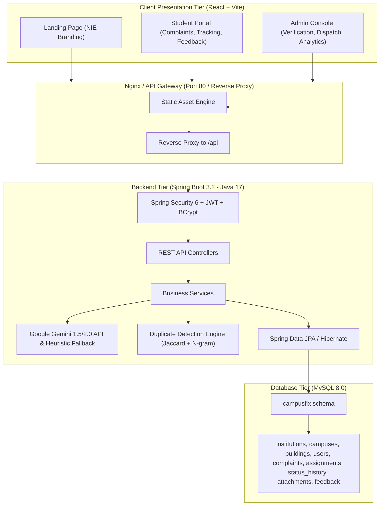
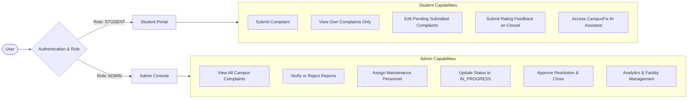
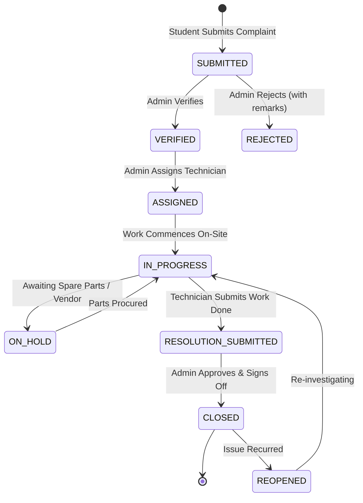
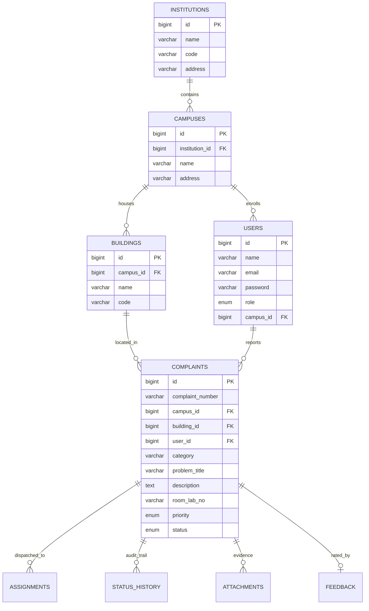

# CampusFix Architecture Specification

## Institution & Campus Identity
- **Institution**: The National Institute of Engineering (NIE), Mysore
- **Campus**: NIE North Campus, Koorgalli Industrial Area, Mysuru - 570018
- **Initial Campus Buildings**:
  1. **Sankaracharya Bhavan** (Code: `SB`)
  2. **Madhvacharya Bhavan** (Code: `MB`)
  3. **Ramanujacharya Bhavan** (Code: `RB`)

---

## High-Level System Architecture

---

## Two-Portal Security Boundary

---

## Complaint State Machine Workflow

---

## Database ER Diagram

